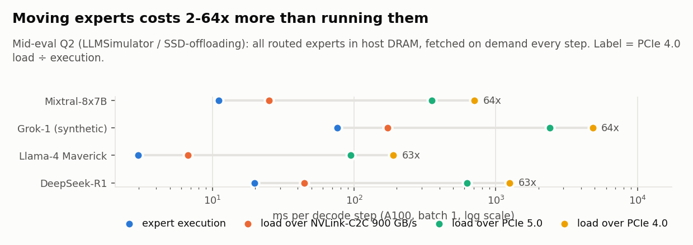
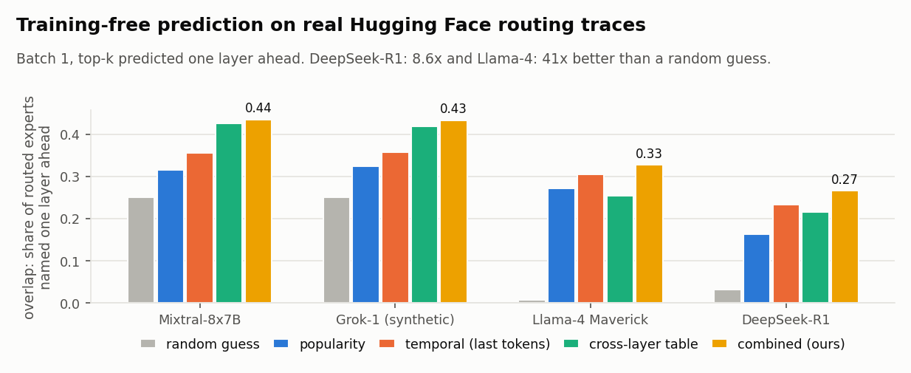
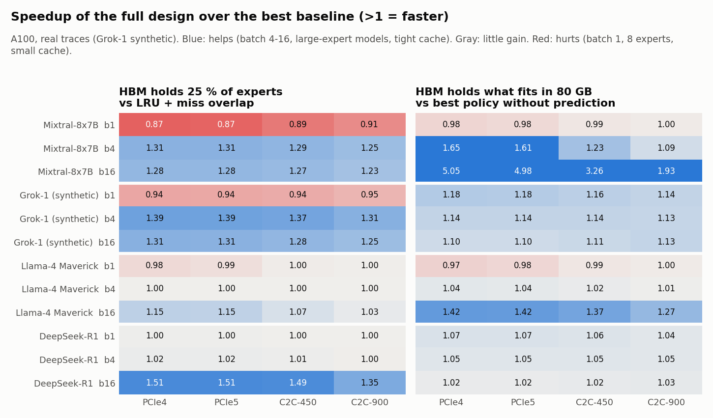
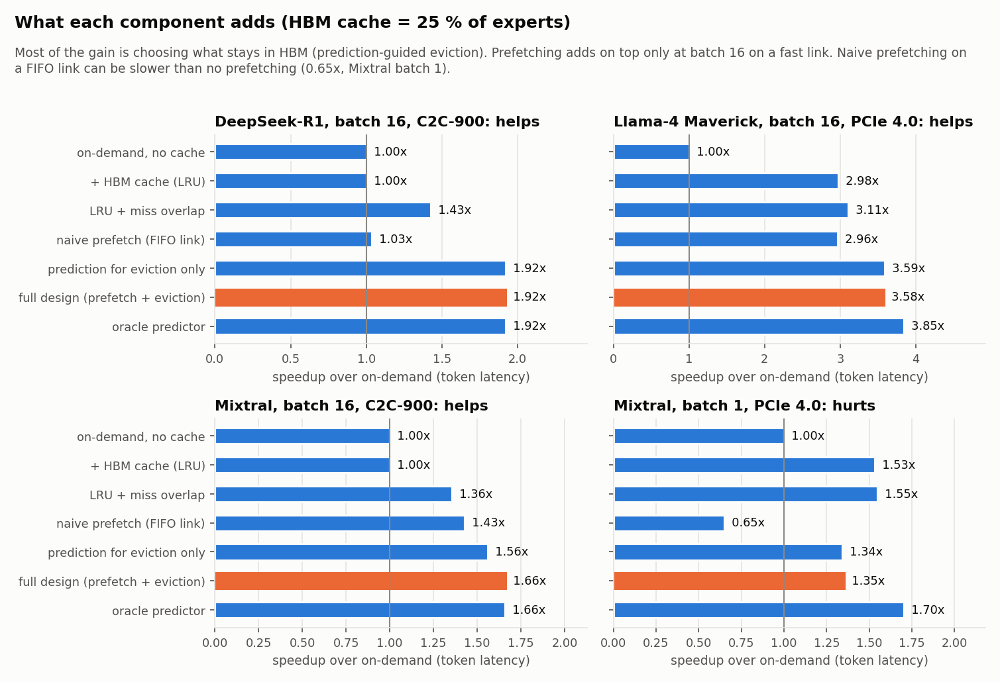
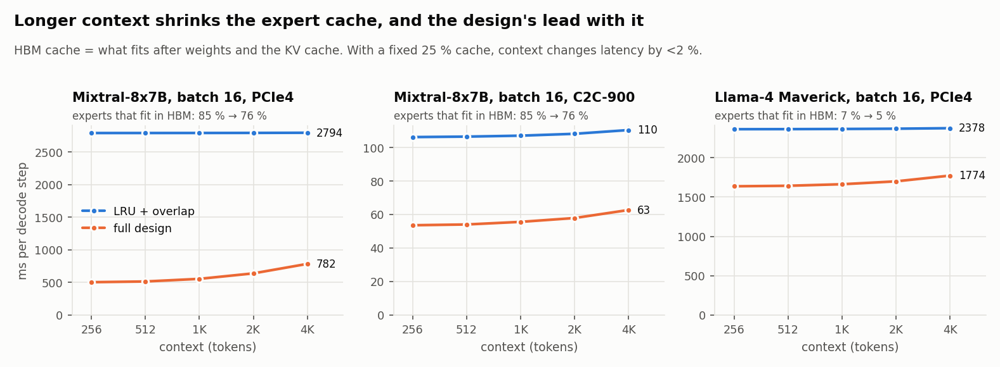
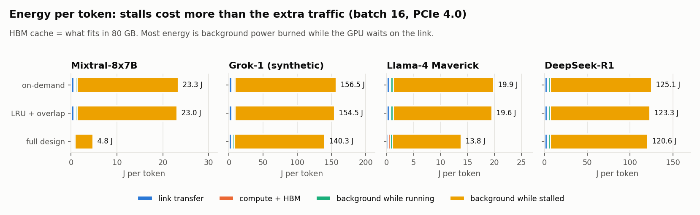
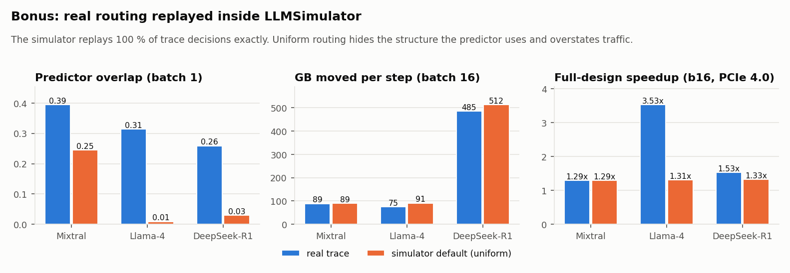

# CA Project 2: The MoE Memory Wall — Predicting and Prefetching Experts

**Group 25** · GitHub: <https://github.com/Alimohammad12314/ca-project>

| Members |
|---|
| Palak Mishra |
| Mohammad Ali |
| Shivansh Bhatnagar |

Course project (Computer Architecture, IIIT Delhi). Mixture-of-Experts (MoE) models are too large for GPU memory, so their
expert weights live in host DRAM and are copied into GPU HBM when the router picks them. That copy is the bottleneck
(the "memory wall"). We **predict** which experts the router will pick next, **prefetch** them into HBM ahead of time, and
choose **which experts stay in HBM**, all training-free.

How we work:
- **Simulation for all main results**, with
  - **LLMSimulator** (scale-snu), the simulator of the MICRO 2024 *Duplex* paper; and
  - **SSD-offloading** (scale-snu), its extension that models expert weights offloaded to host memory.
- **Real routing traces** from Hugging Face (what the router of Mixtral-8x7B, Llama-4 Maverick and DeepSeek-R1 actually
  picked, token by token) drive every end-semester experiment, and are also replayed inside LLMSimulator (bonus).
- An optional **real-GPU validation** on an H100 with the real Mixtral weights: [`endsem/GPU.md`](endsem/GPU.md).

This repository is a fork of SSD-offloading. It adds our experiment code, results and simulator patches.

## Contents

1. [End-semester: prediction, prefetching and HBM management](#end-semester-prediction-prefetching-and-hbm-management)
   - [Results at a glance](#results-at-a-glance): problem, prediction accuracy, where it helps, component contributions,
     context length, energy, bonus, expert-load latency, limitations
2. [References: where each strategy comes from](#references-where-each-strategy-comes-from)
   - [Strategies used in the design](#strategies-used-in-the-design)
   - [Simulators, traces and models](#simulators-traces-and-models)
   - [Reference list](#reference-list)
3. [Mid-evaluation](#mid-evaluation) (Q1-Q4, Q4-extended)
4. [Repository layout](#repository-layout)
5. [Setup on a new machine](#setup-on-a-new-machine)
   - [Prerequisites](#prerequisites)
   - [1. Clone](#1-clone-with-submodules) · [2. Patch and build the simulators](#2-patch-and-build-both-simulators) ·
     [3. Python packages](#3-python-packages) · [4. Regenerate figures](#4-regenerate-figures-fast-no-simulation) ·
     [5. Re-run mid-evaluation simulations](#5-re-run-the-simulations-optional) ·
     [6. End-semester experiments](#6-end-semester-experiments)
6. [Simulation conventions](#simulation-conventions)
7. [Upstream: SSD-offloading](#upstream-ssd-offloading)

Other documents: [`endsem/README.md`](endsem/README.md) (end-semester code and how to run it) ·
[`endsem/DESIGN.md`](endsem/DESIGN.md) (design log and full results) · [`endsem/GPU.md`](endsem/GPU.md) (H100 validation) ·
[`results-ca/README.md`](results-ca/README.md) (mid-evaluation summary)

## End-semester: prediction, prefetching and HBM management

Everything is in [`endsem/`](endsem/README.md). The design log with every decision and the full results is
[`endsem/DESIGN.md`](endsem/DESIGN.md).

| Requirement | What we did | Where |
|---|---|---|
| Training-free prediction, precision / recall on real traces | temporal votes + cross-layer table + popularity, calibrated and combined; overlap, recall, precision, full coverage | `endsem/predictors/`, `experiments/e2_predictor_accuracy.py` |
| Prefetching into HBM: trigger, overlap with compute | after each layer's router runs, predict layers l+1 … l+4 and queue copies; demand misses preempt prefetches at 16 MB chunks; experts run as soon as they arrive | `endsem/engine/timeline.py`, `link.py` |
| Effectiveness: coverage, timely / late, unused, HBM hit rate, extra traffic, exposed stall, expert-load latency, token latency | every simulation reports all of them | columns of every `results/*/*.csv` |
| HBM policy beyond LRU, compared with LRU | predicted-need eviction: P(used within 4 tokens) from prediction + usage rate; also LFU, Belady | `endsem/engine/hbm.py`, e3, e4 |
| Baseline / prediction without prefetch / prefetch / complete system | 11-rung ablation ladder + reference rows | `experiments/e3_ablation.py` |
| Batch, context length, lookahead, aggressiveness | batch 1/4/16, context 256-4096, lookahead cap 1/2/4, coverage target τ | e4, e6 |
| Energy: fewer stalls vs more traffic | transfer (13.4 pJ/bit), dynamic, background energy per token | e4, e5 |
| Bonus: real routing inside the LLM simulator | new `routing.model: trace` in LLMSimulator replays the Hugging Face traces; prefetcher evaluated on that traffic | `experiments/bonus_llmsim_replay.py` |

### Results at a glance

All on a simulated A100-80GB, FP16, all routed experts in host DRAM. Numbers are from `endsem/results/`.

**1. The problem.** Fetching an expert costs 2.3x (NVLink-C2C 900 GB/s) to 64x (PCIe 4.0) more than running it, so an
on-demand system spends 31-68 % (C2C-900) to 93-98 % (PCIe 4.0) of every step waiting on the link (mid-eval Q2).



**2. Prediction works on real routing.** Real routers repeat themselves (the same experts for neighbouring tokens) and
layers are linked (experts at layer l hint at layer l+1). Combining the three predictors beats each one on every model.



**3. Where the design helps, gives little, or hurts.** Blue cells: up to 1.5x with a 25 % cache and up to 5x with the
cache that really fits (Mixtral batch 16). Red cells: batch 1 with 8-expert models and a small cache, 5-13 % slower than LRU.



**4. Why.** Most of the gain comes from deciding what stays in HBM. LRU evicts exactly the expert needed next, because
each decode step walks through the layers in a fixed cycle. Prefetching adds on top only at batch 16 on a fast link. At batch
1 on PCIe 4.0 one 8-expert-model expert takes 11-38 ms to copy while a layer computes in under 0.5 ms, so there is no time
to hide a copy, and wrong guesses (precision ~33 %) block the link a real miss needs.



**5. Context length matters through HBM capacity.** The KV cache grows with context x batch and pushes experts out of HBM.



**6. Energy.** The GPU's idle power while it waits on the link dominates, so cutting stalls saves far more energy than the
extra prefetch traffic costs (21 % fewer bytes and 17 % less energy than the best baseline, 55-66 % less than on-demand).



**7. Bonus: real routing inside LLMSimulator.** The simulator replays 100 % of the traces' decisions exactly, and our
timeline matches its per-step latency within 0.13 %. Its default uniform routing hides what the predictor exploits:
for Llama-4 the design looks 1.3x better than on-demand with uniform routing but is 3.5x better with real routing.



**Expert-load latency** (batch 16, 25 % cache, ms; `results/e3_ablation/ablation.csv`):

| Model, link | one expert, idle link | demand load, LRU + overlap | demand load, full design | wait per needed expert, LRU + overlap → full design |
|---|---|---|---|---|
| Mixtral, C2C-900 | 0.39 | 1.74 | 1.59 | 1.74 → 0.92 |
| Mixtral, PCIe 4.0 | 11.0 | 49.1 | 47.3 | 49.1 → 36.7 |
| DeepSeek-R1, C2C-900 | 0.10 | 4.74 | 3.22 | 4.73 → 2.13 |
| DeepSeek-R1, PCIe 4.0 | 2.75 | 133.4 | 90.7 | 133.1 → 60.0 |

A demand load takes several times the bare copy time because all misses of a layer queue behind each other.

**Limitations.** Grok-1 has no public trace (ours is synthetic, fitted to Mixtral); the DeepSeek-R1 trace is the AWQ
model with 128 decode tokens; the context sweep reuses the same routing at every context; a single simulated A100.

## References: where each strategy comes from

We re-implemented every idea below from the papers' descriptions inside our own trace-driven engine (`endsem/`). No code
was copied from these systems. The strategies are combined in a way none of them uses (calibrated mixing, expected-value
gate, predicted-need eviction), and all of it is training-free.

### Strategies used in the design

| Component in our design | Idea taken | From | How we use it |
|---|---|---|---|
| Cross-layer predictor (`predictors/cross_layer.py`) | experts at layer l predict experts at layer l+d; counters over (expert at l, expert at l+d) | ST-MoE [1] | per-(distance, layer) 4-bit counter tables, d = 1 … 4 |
| Temporal predictor (`predictors/temporal.py`) | consecutive tokens reuse experts | ST-MoE [1]; adjacent-token reuse also reported in [7] | vote over the last W tokens of each sequence; W grows or shrinks with its own hit rate (our design) |
| Popularity prior (`predictors/popularity.py`) | prefetch the experts that are currently popular, from a sliding window | PopFetcher [5] (a training system; we apply the idea to inference) | 64-step window of activation counts per layer |
| Prefetching one layer ahead | predict the next layer's experts and copy them while the current layer computes | Pre-gated MoE [3] (uses a trained pre-gate; ours is training-free) | the base case of our lookahead |
| Adaptive budget (`predictors/budget.py`) | fetch a per-token adaptive number of experts, top-(k + δ), instead of a fixed number | APEX [2] | δ from the empirical distribution of how deep in the ranking routed experts fall; δ = 0 when recall is low |
| Run arrived experts while missing ones load | correctness-preserving mode: missing experts are fetched, nothing is skipped | APEX [2] | "miss overlap" in `engine/timeline.py` |
| Multi-layer lookahead, chunked copies, demand preempts prefetch | sliding-window prefetch d layers ahead; chunked prefetch with early preemption | ProMoE [4] | lookahead up to 4 layers; 16 MB chunks; a demand miss jumps ahead of queued prefetches |
| Adaptive lookahead distance | adjust how far ahead to prefetch from runtime feedback | ExpertFlow [11] | smallest distance whose compute time covers the predicted load |
| Prefetch vs on-demand cost model | prefetching and demand loading compete for PCIe bandwidth; schedule with a cost model | PreScope [10] | priority link + our expected-value gate (prefetch only if p ≥ c / (1 + c)) |
| Link-time cap | only prefetch what the link can deliver before the target layer | SPICE [12] (lookahead sized against PCIe time and compute window) | `link_cap` in the timeline |
| Batch-level view | experts needed by the whole batch, not one token | ExpertFlow (token allocation) [22], DAOP [9] (per-sequence activation patterns) | P(e) = 1 − ∏ (1 − q_b(e)) over the batch's sequences |
| Chooser (`predictors/chooser.py`) | weight several predictors by their recent accuracy | tournament branch predictor [16] | weight = recent recall², per layer and distance |
| HBM cache with retention (`engine/hbm.py`) | keep experts in HBM across tokens; activation-aware caching | MoE-Infinity [6], LRU expert cache of Eliseev & Mazur [7], score-based caching of HybriMoE [8], gate-input-based prefetch of FATE [13] | predicted-need eviction: P(used within 4 tokens) from the prediction and the expert's usage rate |
| Baselines | LRU expert cache; LFU; optimal replacement | [7]; classic LFU; Belady [17] | LRU / LFU / Belady (oracle) eviction |
| Expert maps, fine-grained offloading (related work) | iteration-level expert probability maps | FineMoE [14] | compared in the discussion; not implemented |

### Simulators, traces and models

| What | Source | Used for |
|---|---|---|
| LLMSimulator | Duplex [18], scale-snu/LLMSimulator | Q1; analytic roofline costs |
| SSD-offloading simulator and energy model | Kyung et al. [19], scale-snu/SSD-offloading | Q2-Q4; all expert-load, execution and energy costs (13.4 pJ/bit link energy, 70 W + 57 W background) |
| Ramulator 2.0 | Luo et al. [20] | DRAM model inside LLMSimulator (Q1) |
| Mixtral-8x7B routing trace | `allenai/analysis_mixtral` on Hugging Face (released with OLMoE [21]) | 405 C4 documents, 32 layers, top-2 of 8 |
| DeepSeek-R1 and Llama-4 Maverick routing traces | `core12345/MoE_expert_selection_trace` on Hugging Face (released with *Orders in Chaos* [15]) | AIME 2024, LiveCodeBench, MMLU queries; top-8 of 256 and top-1 of 128 |

### Reference list

1. Y. Zhao, R. Bunescu, A. Louri, A. Karanth, K. Wang. *A Spatio-Temporal Expert Prefetching Framework for Efficient MoE-based LLM Inference* (ST-MoE). arXiv:2606.15453, 2026. Course reference.
2. A. Kanani, L. Badawi, U. Y. Ogras. *APEX: Adaptive Expert Prefetching for Memory-Efficient Edge MoE Inference*. ESWEEK-TCAD 2026, arXiv:2608.11688. Course reference.
3. R. Hwang, J. Wei, S. Cao, C. Hwang, X. Tang, T. Cao, M. Yang. *Pre-gated MoE: An Algorithm-System Co-Design for Fast and Scalable Mixture-of-Expert Inference*. ISCA 2024. arXiv:2308.12066.
4. X. Song, Z. Zhong, R. Chen, H. Chen. *ProMoE: Fast MoE-based LLM Serving using Proactive Caching*. arXiv:2410.22134.
5. J. Zhang et al. *PopFetcher: Towards Accelerated Mixture-of-Experts Training Via Popularity Based Expert-Wise Prefetch*. USENIX ATC 2025.
6. L. Xue, Y. Fu, Z. Lu, L. Mai, M. Marina. *MoE-Infinity: Offloading-Efficient MoE Model Serving*. arXiv:2401.14361.
7. A. Eliseev, D. Mazur. *Fast Inference of Mixture-of-Experts Language Models with Offloading*. arXiv:2312.17238, 2023.
8. S. Zhong, Y. Sun, L. Liang, R. Wang, R. Huang, M. Li. *HybriMoE: Hybrid CPU-GPU Scheduling and Cache Management for Efficient MoE Inference*. DAC 2025. arXiv:2504.05897.
9. Y. Zhang, S. Aggarwal, T. Mitra. *DAOP: Data-Aware Offloading and Predictive Pre-Calculation for Efficient MoE Inference*. DATE 2025. arXiv:2501.10375.
10. E. Yu, Z. Zhang, D. Dong, Y. Wu, X. Liao. *PreScope: Unleashing the Power of Prefetching for Resource-Constrained MoE Inference*. arXiv:2509.23638.
11. Z. Shen, K. Chu, Y. Zhang, D. Xiang, R. Wu, W. Zhang. *ExpertFlow: Adaptive Expert Scheduling and Memory Coordination for Efficient MoE Inference*. arXiv:2510.26730, 2025.
12. *SPICE: Speculative Prefetching with Low-Rank Expert Surrogates and Heterogeneous Orchestration for MoE Inference Acceleration*. arXiv:2608.21240, 2026.
13. Z. Fang, Z. Hong, Y. Huang, Y. Lyu, W. Chen, Y. Yu, F. Yu, Z. Zheng. *Fate: Fast Edge Inference of Mixture-of-Experts Models via Cross-Layer Gate*. arXiv:2502.12224, 2025.
14. H. Yu, X. Cui, H. Zhang, H. Wang. *Taming Latency-Memory Trade-Off in MoE-Based LLM Serving via Fine-Grained Expert Offloading* (FineMoE). EuroSys 2026. arXiv:2502.05370.
15. *Orders in Chaos: Enhancing Large-Scale MoE LLM Serving with Data Movement Forecasting*. arXiv:2510.05497 (source of the DeepSeek-R1 and Llama-4 traces).
16. S. McFarling. *Combining Branch Predictors*. DEC WRL Technical Note TN-36, 1993.
17. L. A. Belady. *A Study of Replacement Algorithms for a Virtual-Storage Computer*. IBM Systems Journal 5(2), 1966.
18. S. Yun, K. Kyung, J. Cho, J. Choi, J. Kim, B. Kim, S. Lee, K. Sohn, J. H. Ahn. *Duplex: A Device for Large Language Models with Mixture of Experts, Grouped Query Attention, and Continuous Batching*. MICRO 2024. arXiv:2409.01141.
19. K. Kyung, S. Yun, J. H. Ahn. *SSD Offloading for LLM Mixture-of-Experts Weights Considered Harmful in Energy Efficiency*. IEEE Computer Architecture Letters, 2025. arXiv:2508.06978.
20. H. Luo et al. *Ramulator 2.0: A Modern, Modular, and Extensible DRAM Simulator*. IEEE Computer Architecture Letters, 2023.
21. N. Muennighoff et al. *OLMoE: Open Mixture-of-Experts Language Models*. arXiv:2409.02060, 2024.
22. X. He et al. *ExpertFlow: Optimized Expert Activation and Token Allocation for Efficient Mixture-of-Experts Inference*. arXiv:2410.17954, 2024.

Note: our planning notes called the temporal vote window "STEP"; we could not find a published paper of that name, so the
window and its adaptive size are listed as our own design, built on the token-to-token correlation reported in [1] and [7].

## Mid-evaluation

| Mid-evaluation item | Where |
|---|---|
| Q1 Reproduce the Duplex configuration | [`results-ca/q1_duplex_reproduction/`](results-ca/q1_duplex_reproduction/README.md) |
| Q2 Single GPU, no expert sharding, no Logic-PIM, experts in off-chip DRAM: expert loading vs execution time | [`results-ca/q2_offload_load_vs_exec/`](results-ca/q2_offload_load_vs_exec/README.md) |
| Q3 MoE execution flow and why expert loading is the bottleneck | [`results-ca/q3_moe_flow_bottleneck/`](results-ca/q3_moe_flow_bottleneck/README.md) |
| Q4 Temporal and spatial correlation of expert accesses | [`results-ca/q4_expert_correlation/`](results-ca/q4_expert_correlation/README.md) |
| Q4-extended Do expert relations emerge from the router's own logic? | [`results-ca/q4_extended_router_logic/`](results-ca/q4_extended_router_logic/README.md) |

The overview of all results is in [`results-ca/README.md`](results-ca/README.md).

## Repository layout
```
.
├── setup.sh                     # one-time setup: submodules + all patches + build both simulators
├── LLMSimulator/                # submodule: SSD-offloading's LLMSimulator copy (GPU-only + offloading) -> Q2-Q4
├── external/LLMSimulator/       # submodule: original LLMSimulator (Duplex, Logic-PIM)                  -> Q1
├── patch/ssd_offloading.patch   # upstream SSD-offloading patch (applied by setup.sh / patches.sh)
├── patches.sh                   # upstream patch script (kept for reference; setup.sh supersedes it)
├── docs/figures/                # the README figures (built by endsem/experiments/readme_figures.py)
├── endsem/                      # end-semester: predictor, prefetcher, HBM policy, experiments, results
│   ├── README.md, DESIGN.md     # how to run / design log and all results
│   ├── GPU.md                   # real-GPU (H100) validation guide with the real Mixtral weights
│   ├── traces/ predictors/ engine/ experiments/ tests/
│   └── results/                 # CSV tables of every experiment (e0-e6, bonus)
└── results-ca/                  # mid-evaluation
    ├── README.md                # summary of all mid-evaluation results
    ├── q1_.. q4_../             # per question: README (method + results), data/, runs/ (exact configs + raw output)
    ├── scripts/                 # every script used (simulation sweeps, analysis, plots)
    ├── configs/                 # base configs used for all runs
    ├── simulator_patches/       # our changes to both simulators (+ README explaining each change)
    └── requirements.txt
```

## Setup on a new machine

### Prerequisites
Tested on Ubuntu 20.04 with g++ 11.4, cmake 3.16, clang 10, Python 3.8 (mid-evaluation: numpy 1.24, pandas 2.0, scipy 1.10, matplotlib 3.7, PyYAML 5.3) and Python 3.10 (end-semester). No GPU is needed.

```bash
sudo apt install build-essential g++-11 cmake clang git python3-pip   # if not already installed
```

### 1. Clone (with submodules)
```bash
git clone --recursive https://github.com/Alimohammad12314/ca-project.git
cd ca-project
```
If you cloned without `--recursive`, `setup.sh` fetches the submodules for you.

### 2. Patch and build both simulators
```bash
./setup.sh          # about 5-10 min; set JOBS=8 to limit parallel compile jobs
```
`setup.sh` is safe to re-run. In order, it:
1. fetches both submodules (and their nested Ramulator 2.0 submodule);
2. applies the upstream patches: `ramulator2_pim.patch` (both simulators) and `patch/ssd_offloading.patch`;
3. applies our patches from `results-ca/simulator_patches/` (see its [README](results-ca/simulator_patches/README.md)): PCIe link bandwidth option, A100 support, routing models (incl. the Q4-extended router model and the end-semester `trace` replay of real routing) and routing log, MoE-layer counter fix, expert-RNG bias fix, config caching, and the `llama3_70B` / `glam` presets;
4. builds `LLMSimulator/build/run` and `external/LLMSimulator/build/run`.

### 3. Python packages
```bash
pip install -r results-ca/requirements.txt
```

### 4. Regenerate figures (fast, no simulation)
Figures are not committed (binary files), except the README figures in `docs/figures/`. Rebuild them from the committed data:
```bash
cd results-ca
python3 scripts/plot_q1.py        # Q1 figures
python3 scripts/plot_q2_q3.py     # Q2 + Q3 figures
python3 scripts/q4_analysis.py    # Q4 statistics + figures (reads runs/*/routing_log.csv)
python3 scripts/q4x_analysis.py --plots-only   # Q4-extended figures
```

### 5. Re-run the simulations (optional)
```bash
cd results-ca
python3 scripts/q1_duplex.py          # 207 runs,  ~3 min on 28 cores
python3 scripts/q2_offload.py         # 369 runs,  ~5 min
python3 scripts/q4_routing_runs.py    # 12 runs,   ~5 min
python3 scripts/q4x_router_runs.py   # 66 runs,   ~15 min (Q4-extended)
```
Each script writes `data/` and `runs/` in its question folder. To use simulator builds elsewhere, set `LLMSIM_ROOT` (original) or `SSDSIM_ROOT` (SSD-offloading copy) to the simulator directory that contains `build/run`.

### 6. End-semester experiments
```bash
cd endsem
python3.10 -m venv .venv && . .venv/bin/activate        # or: uv venv .venv --python 3.10
pip install numpy pandas matplotlib scipy pytest pyyaml huggingface_hub

python -m traces.download mixtral                       # open dataset (allenai/analysis_mixtral)
hf auth login                                           # accept the terms of core12345/MoE_expert_selection_trace first
python -m traces.download llama4_maverick deepseekR1    # gated dataset
python -m traces.synthetic grok1                        # no public Grok-1 trace: calibrated to Mixtral

python -m pytest -q tests
python -m experiments.e0_validation_gate                # must print GATE PASSED (timeline = Q2 on-demand)
python -m experiments.e1_trace_stats                    # how predictable real routing is
python -m experiments.e2_predictor_accuracy             # precision / recall / overlap          ~10 min
python -m experiments.e3_ablation                       # what each component adds              ~40 min on 28 cores
python -m experiments.e4_sweeps                         # link x cache x batch, lookahead, tau  ~30 min
python -m experiments.e5_tradeoffs                      # predictor cost, budget vs traffic and energy
python -m experiments.ctx_base_runs                     # LLMSimulator base pass at context 256-4096 (needs ./setup.sh)
python -m experiments.e6_context                        # context-length sweep                  ~25 min
python -m experiments.bonus_llmsim_replay               # real routing inside LLMSimulator      ~15 min
python -m experiments.report                            # results/headline.csv
python -m experiments.readme_figures                    # docs/figures/*.png
```
Traces (~11 GB with cached prediction streams) go to `endsem/data/`, which is not committed. Every experiment takes
`--models` to run a subset. Details: [`endsem/README.md`](endsem/README.md).

## Simulation conventions
- Simulator CSV output: latency in ns, energy in nJ. Our tables use ms and J.
- Decode mode: one decode step generates one token per sequence in the batch. FP16 weights.
- HBM capacity is not enforced by LLMSimulator; the end-semester timeline enforces it (cache ratio = share of all routed
  experts that HBM holds; "physical" = what fits in 80 GB after non-expert weights and the KV cache).

---

## Upstream: SSD-offloading
This modeling tool builds upon the [simulator](https://github.com/scale-snu/LLMSimulator.git) introduced in the MICRO 2024 paper "Duplex: A Device for Large Language Models with Mixture of Experts, Grouped Query Attention, and Continuous Batching." It breaks down the energy consumption and token generation latency of LLM inference per operation (e.g., QKV generation, attention, output projection). For Mixture-of-Experts (MoE) models, the breakdown can be split by whether the gated expert weights are offloaded to CPU memory or SSD.

Key features:
- The CPU-memory and SSD read bandwidths are modeled, together with the resulting reduction in device-memory bandwidth available for GPU compute when offloaded weights are read concurrently with the GPU compute.
- The memory/storage access energy, the GPU compute energy and the latency are calculated by the tool.
- In the experimental workflow, the resulting latency is used to calculate the background energy due to the memory's static power and the GPU's idle power.

Upstream experiment workflow (after `setup.sh`): `cd LLMSimulator && python figure_4_and_5.py` and `python figure_6.py`.

Upstream contact: Kwanhee Kyung (kwanhee.kyung@scale.snu.ac.kr), Sungmin Yun (sungmin.yun@snu.ac.kr).
