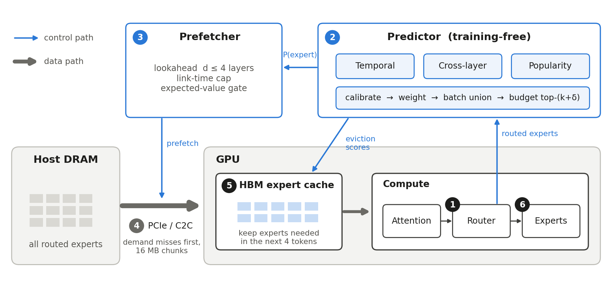

# Design log: training-free expert prediction, prefetching and HBM management

Project 2 (MoE memory wall), Group 25. This file is the in-repository copy of the design log; it
records what was built, every change from the plan, and the measurement that forced it.
Results tables are in the last section and in `results/`. Full citations for every source named
below: the References section of the repository README.

## 1. Starting point

The input was the plan *MoE Memory Wall: Papers and Proposed Design for the Final Submission*:
a training-free prefetcher that puts ST-MoE's correlation tables, STEP's adaptive temporal window (ISCA 2026), APEX's
adaptive top-(k+delta) budget and ProMoE's multi-layer lookahead in front of a bounded HBM expert
cache. All experts live off-chip; HBM holds a bounded cache; routing stays exact (no pruning).
The zero-cache timeline must reproduce the mid-eval on-demand numbers (Mixtral, A100, batch 1:
37.5 ms on C2C-900, 717 ms on PCIe 4.0).

## 2. Goals

- Maximise overlap accuracy (share of routed experts named in advance).
- Minimise token latency (exposed stall waiting on the DRAM-to-HBM link).
- Measure the prediction/prefetch trade-off: wasted traffic, HBM contention, energy, predictor
  time and memory.
- Report the metrics recent papers use: recall, full coverage, precision / wasted prefetches,
  timeliness, batch-union accuracy, stall, p95 latency, traffic, link utilisation, energy, EDP,
  predictor state size.

## 3. Design as built

Predictions depend only on routing history, never on timing, so they are computed once per
(model, batch, predictor configuration) as a *prediction stream* and replayed by every timeline run.

| # | Component | As built | Source idea |
|---|---|---|---|
| 1 | Traces | `[request, token, layer, top-k]` + prompt routing for warm-up; B requests decode together | plan step 1 |
| 2 | Temporal predictor | votes over the last W tokens per sequence and layer; W doubles after 2 windows > 75 % hit rate, halves < 40 % | STEP (adaptive window); ST-MoE history table |
| 3 | Cross-layer predictor | per (distance d, layer) counters for (expert at l, expert at l+d); row halving on overflow; 4-bit | ST-MoE; ProMoE / FineMoE distance |
| 4 | Popularity prior | sliding 64-step window of batch counts per layer | PopFetcher; LFU |
| 5 | Rank calibration | each predictor's rank -> probability via an online hit-rate-per-rank table | new (section 4) |
| 6 | Chooser | weight = EMA recall^2 per (layer, distance) over calibrated probabilities | tournament predictor; DAOP |
| 7 | Batch union | P(e) = 1 - prod_b (1 - q_b(e)) | ExpertFlow batch view |
| 8 | Adaptive budget | M = K_hat + tau-quantile of the last 64 oracle delta*; delta = 0 when recall < 40 % | APEX (empirical CDF); STEP off-switch |
| 9 | Lookahead | smallest d whose compute covers the predicted load, cap 4; crosses the token boundary | ProMoE stride; ExpertFlow adaptive step |
| 10 | Link | FIFO, or demand misses preempt prefetches at 16 MB chunks; late prefetches promoted; stale ones dropped | ProMoE; PreScope; SPICE |
| 11 | Link-time cap | prefetch only what the link can deliver before the target layer | SpecPrefetch |
| 12 | Expected-value gate | prefetch e only if p(e) >= c / (1 + c), c = (1 - 1/f) + link utilisation | new (section 4) |
| 13 | HBM cache | ratio x all experts; LRU / LFU / need / Belady; pins; early-layer bonus; need = P(used within 4 tokens) | MoE-Infinity; FATE; HybriMoE |
| 14 | Miss handling | run arrived experts while missing ones load | APEX correctness-preserving mode |
| 15 | Costs | LLMSimulator roofline + Q2 non-expert time; SSD-offloading contention (HBM BW - link BW) and energy | mid-eval Q2 |

## 4. Thought process (in the order it happened)

| Step | What I saw | What I changed | Why |
|---|---|---|---|
| Simulator | LLMServingSim works per batch and needs ASTRA-Sim; the Q2 numbers come from LLMSimulator / SSD-offloading | own trace-driven timeline here, costs from LLMSimulator and Q2 | END_SEM_PLAN D1 |
| Traces | Mixtral open; DeepSeek-R1 and Maverick gated (core12345/MoE_expert_selection_trace); no Grok-1 trace exists | real traces for 3 models; Grok-1 synthetic, fitted per layer to Mixtral | plan risk table |
| Validation gate | exact at batch 1; up to 8 % off at batch 4 | batch > 1 gated per unique expert | Q2 ran one decode step: its unique-expert count is one random draw (5.06 vs exact 5.47) |
| First combiner | mix scored 0.389 overlap, below cross-layer alone (0.427) | rank calibration before mixing | peaky temporal votes drowned the flatter but better cross-layer scores |
| Counter width | Mixtral: 2-bit 0.416, 4-bit 0.429, 8-bit 0.432 | 4-bit default; 2/8 reported | 2-bit saturating counters lose the ranking among frequent pairs |
| Combining rule | mean vs log-odds, gamma 2 vs 8 within 0.008 | kept hit-rate weighting (gamma 2) | after calibration the rule matters little; no tuning on the test trace |
| LRU at batch 4/16 | cache gave 1.00x | predicted-need eviction | each step sweeps layers cyclically; when a step's experts exceed the cache, LRU evicts exactly what comes next |
| Naive prefetch | rungs 3-5 at 0.62-0.95x of on-demand (batch 1) | priority link, link cap, stale cancel | wrong guesses blocked demand misses and polluted the cache |
| C2C-900 | full design 1.40x vs 1.51x for LRU + miss overlap with no prediction | expected-value gate | a 900 GB/s copy takes 44 % of A100 HBM bandwidth; at ~33 % precision, wasted copies cost more than correct ones save |
| Grok-1 generator | plain mixture: reuse 0.27, cross 0.31 vs Mixtral 0.36, 0.42 | sharpen the real transition tables (beta fitted per layer) | a token's hidden state drives both correlations together; a mixture dilutes them |
| DeepSeek-R1 files | 3 of 30 AIME files malformed; 10 queries with 1 decode token | cut at the first malformed token; keep >= 8 tokens | 94 queries with 128 tokens remain |
| Eviction horizon | Maverick batch 1: need eviction hit less than LRU (0.83 vs 0.85); batch 4 PCIe4: 1.22x slower than LRU + overlap | score = P(used within H tokens) = 1 - (1 - p_next)(1 - u)^H, H = 4 | skewed popularity makes experts reusable beyond the next token; H tuned on these traces (mean 0.847x, worst 1.016x of LRU + overlap) |
| Counter width, large N | DeepSeek-R1 / Maverick: 2-bit equal or better (0.270 vs 0.264) | 4-bit stays default, 2-bit reported | rows age faster with 2 bits; half the state |
| Contention over-count (bug) | oracle slower than the full design (81 vs 62 ms, Maverick b16 C2C-900); 30 ms of slowdown where 12.5 ms is the physical maximum | bring the link up to "now" before estimating its busy window | the link's clock lagged compute with queued work counted as still ahead; it inflated every prefetch's cost, including the earlier C2C-900 case for the value gate |
| Usage rate saturated (bug) | experts used once after loading scored 1.0; oracle issued 0.5 prefetches/token instead of 16 | rate = uses / (age + H) | prefetches could never evict anything |
| Next-token eviction is myopic | after the fixes, a perfect next-token oracle with myopic eviction ran at 0.60x LRU on Maverick | eviction = prediction + smoothed usage rate (H = 4); recency blends tested (1.04-1.06x) | retention needs reuse evidence over many tokens; rate score best mean (1.20x LRU + overlap), loses 2-13 % in 11 of 72 settings (batch 1, 8 experts, 25 % cache) |
| Simulator speed | DeepSeek-R1 batch 16 runs took ~45 s per 64 steps | pick all of a layer's victims in one partial sort | victim scores cannot change within a layer; same results, 24x faster |

Not used: hidden-state predictors (traces hold IDs only), trained predictors (plan is training-free),
expert pruning or substitution (changes outputs the simulator cannot score), integration into
LLMServingSim (needs GPU-profiled tables and an expert-level hook).

## 5. Changes made

All new files under `endsem/`. Outside it, the only change is one new routing model in the SSD-offloading
simulator (`routing.model: trace`, in `results-ca/simulator_patches/ssd_offloading_llmsim.patch`) for the bonus. See the README's folder
map. Traces and streams are in `endsem/data/` (git-ignored).

## 6. Validation

- Gate (`results/e0_validation`): batch 1, 32 points, worst error 0.052 % (Mixtral A100: 37.5088 ms
  C2C-900, 717.0979 ms PCIe 4.0, identical to Q2); batch 4/16, 64 points, worst 0.14 % per unique expert.
- Traces: Mixtral `allenai/analysis_mixtral` (405 C4 documents, 32 layers, top-2/8); Llama-4 Maverick
  and DeepSeek-R1 (AWQ) from `core12345/MoE_expert_selection_trace` (AIME 2024, LiveCodeBench, MMLU;
  122 and 94 queries x 128 decode tokens; 24 and 57 MoE layers; top-1/128 and top-8/256); Grok-1 synthetic.
- No leakage: a prediction d layers ahead sees routing up to layer l - d of the current token only.
- 6 unit tests pass.

## 7. Results (A100, all numbers from `results/`)

**Prediction accuracy (e2).** Overlap one layer ahead, batch 1: combined predictor 0.266 (DeepSeek-R1,
8.6x random), 0.328 (Maverick, 41x), 0.435 (Mixtral), 0.434 (Grok-1 synthetic); better than every single
predictor on every model. Full coverage with the adaptive budget: 54 % Mixtral, 39 % Maverick, 1.7 % DeepSeek-R1.

**Ablation (e3, 96 settings: 4 links x batch 1/4/16 x cache 25/50 %).** Full design vs best policy without
prediction: 1.19x geometric mean, up to 2.25x, wins or ties in 80 of 96. Naive prefetching on a FIFO link
(rungs 3-5) is slower than the cache alone. Predicted-need eviction + miss overlap is the largest step.
Prefetching on top of prediction-guided eviction adds 0.7 % (max 7 %, batch 16 on NVLink-C2C); the value gate
changes results by under 2 % after the contention fix. Remaining headroom to oracle + Belady: 1.41x.

**Realistic HBM (e4, cache that fits in 80 GB).** Full design vs best baseline / vs on-demand:

| Model | Cache | vs best baseline | vs on-demand | Settings won |
|---|---|---|---|---|
| Mixtral | 84 % | 1.69x (up to 5.05x) | 4.45x | 10 of 12 |
| Llama-4 Maverick | 6.7 % | 1.12x | 1.72x | 10 of 12 |
| Grok-1 (synthetic) | 11 % | 1.14x | 1.27x | 12 of 12 |
| DeepSeek-R1 | 1.8 % | 1.04x | 1.19x | 12 of 12 |

Over all 240 sweep settings the full design is at least as fast as the best baseline in 87 %.

**Traffic and energy.** 21 % fewer bytes and 17 % less energy per token than the best baseline (geometric
means); 55-66 % less energy than on-demand.

**Trade-offs (e5).** Predictor off the critical path: no cost up to 1 ms per layer (<= 0.2 %). On the critical
path: +2 % at 50 us, +8 % at 200 us, +35 % at 1 ms. Python implementation 0.9-6.3 ms per layer (must run off
the path); compiled estimate 0.6-236 us. Predictor state 39 KiB (Mixtral) to 8.7 MiB (DeepSeek-R1, mostly the
N x N cross-layer tables). Fixed top-k / top-(k+x) and the adaptive budget at tau 0.6-0.9 are within 2 % in
latency and energy; the adaptive budget wastes 0.045 GB/token vs 1.85-3.1 GB for fixed budgets. tau and
lookahead cap change latency by under 1.1 %.

**Expert-load latency (e3, columns `expert_load_*`, `demand_load_latency_ms`, `expert_wait_ms`).** Moving one
expert over an idle link takes 0.39 ms (Mixtral, C2C-900) to 37.8 ms (Grok-1, PCIe 4.0). A demand load takes 3-12x
that, because all misses of a layer queue behind each other (Mixtral batch 16, PCIe 4.0: 49 ms vs 11 ms). The full design
cuts the wait per needed expert most where retention is the problem: DeepSeek-R1 batch 16 from 133 to 60 ms (PCIe 4.0)
and 4.7 to 2.1 ms (C2C-900); Mixtral batch 16, C2C-900, from 1.74 to 0.92 ms. Prefetching shows up only at batch 16 on
C2C-900: eviction-only waits 1.33 ms (Mixtral) and 4.33 ms (Grok-1), the full design 0.92 and 2.87 ms. Prefetched copies
themselves take longer (Mixtral 4.2 ms vs 1.6 ms for demand copies), because they yield to demand copies at every 16 MB
chunk. At batch 1 with 8 experts the full design waits longer than LRU (Mixtral PCIe 4.0: 11.4 vs 9.3 ms), the known
small-cache failure case.

**Context length (e6, 256-4096 tokens, costs from LLMSimulator's base pass at each context).** Context matters through
HBM capacity, not through attention time:
- With a fixed 25 % cache, token latency changes by under 2 % from 256 to 4096 tokens (Maverick batch 16 C2C-900, the
  largest: 59.9 to 66.3 ms). Expert loading is 10-1000x the attention time, and the full design's gain over LRU + overlap
  stays within 0.01 across contexts.
- With the cache that physically fits, the KV cache crowds experts out (Mixtral batch 16: 85 % of experts fit at 256 tokens,
  76 % at 4096). Mixtral batch 16 PCIe 4.0: hit rate 0.83 to 0.73, latency 501 to 782 ms (+56 %), energy 4.4 to 6.7 J/token.
  The full design's advantage over LRU + overlap shrinks from 5.6x to 3.6x (C2C-900: 1.98x to 1.76x), and Maverick batch 16
  from 1.44x to 1.34x. A shrinking cache leaves fewer slots for the predictor to protect.
- Batch 1 barely moves (KV for one sequence is small), so context and batch interact: the KV cache grows with
  context x batch.

**Bonus: real routing inside LLMSimulator (`results/bonus_llmsim/`).** The SSD-offloading simulator replays the Hugging Face
traces (`routing.model: trace`, any top-k) for 128 decode steps, batch 1/4/16, A100, PCIe 4.0 and C2C-900:
- Exact replay: the simulator's own routing log equals the input trace for 100 % of decisions (3 models x 3 batches).
- The timeline (constant Q2 costs) reproduces the simulator's on-demand latency step by step: mean error <= 0.13 %,
  per-step correlation 0.999-1.000.
- Real routing creates less traffic than the simulator's default uniform routing, because sequences of a batch share
  experts: Maverick batch 16 74.8 vs 91.2 GB per step (-18 %, on-demand 2388 vs 2908 ms on PCIe 4.0), DeepSeek-R1
  batch 16 484.5 vs 512.1 GB (-5 %), Mixtral within 0.5 % (it needs nearly all 8 experts anyway).
- On the simulator's traffic, the predictor finds structure only in real routing: overlap one layer ahead, real vs
  uniform, DeepSeek-R1 batch 1 0.26 vs 0.03, Maverick 0.31 vs 0.01, Mixtral 0.39 vs 0.25 (chance level).
- Speedup of the full design over on-demand (25 % cache), real vs uniform: Maverick batch 16 PCIe 4.0 3.53x vs 1.31x,
  DeepSeek-R1 batch 16 PCIe 4.0 1.53x vs 1.33x, Mixtral batch 16 1.29x vs 1.29x. Synthetic routing underestimates the
  design by up to 2.7x on large-expert models. For Mixtral the gain comes from beating LRU's cyclic eviction, which works
  on any routing.

**When prefetching helps, gives little, or hurts (summary of e3-e6 and the bonus).**
- *Helps:* batch 4-16 on large-expert models (DeepSeek-R1, Maverick) and 8-expert models at batch 16 on fast links,
  when the cache cannot hold one step's experts. Here LRU evicts exactly what comes next, and prediction-guided eviction
  plus a few timely prefetches give 1.2-1.5x over LRU + overlap at 25 % cache, and up to 5.6x with Mixtral's physical cache (batch 16, PCIe 4.0).
- *Little gain:* batch 1 on a slow link. One expert takes 11-38 ms on PCIe 4.0 but a layer computes in ~0.05-0.4 ms, so
  the link-time cap issues almost no prefetches and the design falls back to its eviction policy. Also when the cache
  shrinks (long context x large batch): fewer slots to protect.
- *Hurts:* batch 1, 8 experts, small cache (Mixtral/Grok-1, 25 %), 5-13 % slower than LRU + overlap. Precision is ~33 %,
  so most speculative copies are wasted, they occupy the link a demand miss needs next, and on C2C-900 they also slow
  compute through HBM contention. The value gate limits but does not remove this.
- *Interaction:* accuracy sets how many copies are useful, timing (link time vs compute window) sets how many can arrive
  in time, traffic sets the cost of each wrong guess (link blocked, contention, 13.4 pJ/bit), and the HBM policy decides
  whether a correct guess survives until it is used. Retention dominates in every setting we measured.

**Conclusion.** ID-only, training-free prediction on real routing pays off mainly through retention
(choosing what stays in HBM), not through prefetching, as the mid-eval bound predicted. Prefetching helps only
at larger batch on fast links. The gap to the oracle (1.41x) is prediction accuracy and eviction foresight.

## 8. Limitations and next steps

Grok-1 is synthetic; the DeepSeek-R1 trace is the AWQ model with 128 decode tokens; decode only (prefill only
warms predictors); full N x N cross-layer tables (keep top-8 candidates per row, ~0.9 MB for DeepSeek-R1);
H = 4 and the early-layer bonus tuned on these traces (validate on held-out benchmarks); batch-1 8-expert
small-cache regime loses to LRU by up to 13 % (set dueling between LRU and the rate score, as in DIP);
no hidden-state predictors; A100 single GPU only (`--gpu H100` supported, not swept). The context sweep keeps the
same routing at every context (the traces are too short to replay 4096-token positions), so it captures attention time
and HBM capacity, not position-dependent routing. Real-GPU validation of the cost model is planned in GPU.md.
