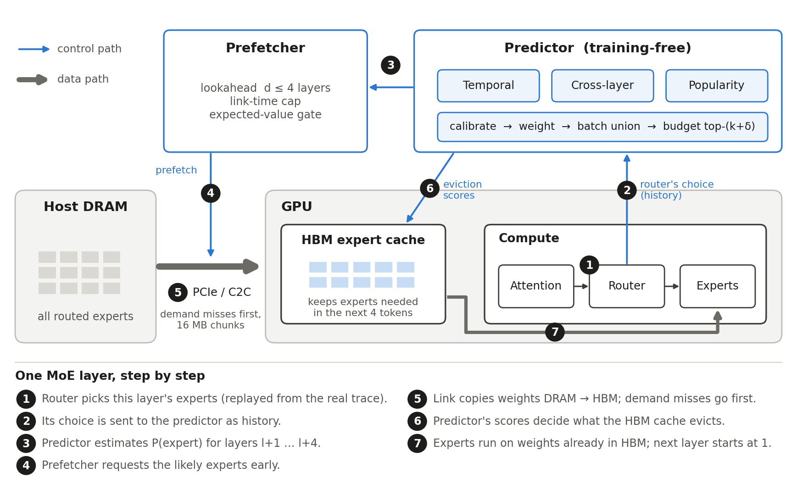

# End-semester: expert prediction, prefetching and HBM management (Group 25)

A training-free expert predictor, a prefetcher that moves predicted experts from host DRAM into
GPU HBM ahead of time, and an HBM eviction policy, all evaluated on **real MoE routing traces from
Hugging Face** in a trace-driven timeline whose costs come from LLMSimulator / SSD-offloading
(the mid-evaluation Q2 runs). The design log, with every decision and why, is in
[DESIGN.md](DESIGN.md).



## Folder map

```
endsem/
├── README.md, DESIGN.md
├── traces/        1. what the router actually picked
│   ├── format.py      one trace format for every model: [request, token, layer, top-k]
│   ├── download.py    Hugging Face -> data/traces/<model>.npz
│   ├── synthetic.py   calibrated stand-in for Grok-1 (no public trace exists)
│   ├── workload.py    batches of requests decoded step by step
│   └── stats.py       Q4 statistics (reuse, cross-layer hit) vs a shuffled baseline
├── predictors/    2. which experts will be needed next
│   ├── temporal.py    STEP vote window (last W tokens, adaptive W)
│   ├── cross_layer.py ST-MoE correlation table, layer l -> l+d
│   ├── popularity.py  sliding-window frequency
│   ├── calibration.py rank -> probability, online
│   ├── chooser.py     weights predictors by recent hit rate
│   ├── budget.py      APEX top-(k+delta), empirical CDF, off-switch
│   └── stream.py      runs all of the above over a workload, scores them offline
├── engine/        3. when experts arrive and what stays in HBM
│   ├── costs.py       time/energy from LLMSimulator presets and Q2 results
│   ├── link.py        DRAM->HBM link: FIFO or demand-preempts-prefetch, chunked
│   ├── hbm.py         bounded expert cache: LRU / LFU / predicted-need / Belady
│   ├── timeline.py    per-layer decode timeline: compute, link, cache, prefetcher
│   └── energy.py      transfer, dynamic and background energy
├── experiments/   4. scripts that produce every result
│   ├── common.py      workloads, cached prediction streams, the ablation ladder
│   ├── e0_validation_gate.py   timeline vs Q2 on-demand numbers (must pass first)
│   ├── e1_trace_stats.py       predictability of real routing
│   ├── e2_predictor_accuracy.py Deliverable 1: overlap, coverage, precision
│   ├── e3_ablation.py          what each component adds
│   ├── e4_sweeps.py            Deliverables 3-4: link x cache x batch x model
│   ├── e5_tradeoffs.py         predictor overhead, budget vs traffic and energy
│   ├── ctx_base_runs.py        LLMSimulator base pass at context 256-4096 (costs for e6)
│   ├── e6_context.py           sensitivity to context length (KV time + HBM left for experts)
│   ├── bonus_llmsim_replay.py  bonus: real routing replayed inside LLMSimulator, prefetcher on that traffic
│   ├── readme_figures.py       docs/figures/*.png for the repository README
│   └── architecture_diagram.py architecture_v3.png
├── results/       CSV tables per experiment (plots/*.png are regenerated, not committed)
├── tests/         unit tests (link preemption, ranks, counters, budget, gate)
└── data/          downloaded traces and cached streams (not committed; regenerate below)
```

## Run everything, in order

```bash
cd endsem
uv venv .venv --python 3.10 && . .venv/bin/activate
uv pip install numpy pandas matplotlib huggingface_hub scipy pytest pyyaml

# 1. traces
python -m traces.download mixtral                       # open dataset
hf auth login                                           # after accepting the dataset terms at
                                                        # huggingface.co/datasets/core12345/MoE_expert_selection_trace
python -m traces.download llama4_maverick deepseekR1    # gated dataset
python -m traces.synthetic grok1                        # calibrated to the Mixtral trace

# 2. check, then experiments (each writes results/<name>/)
python -m pytest -q tests
python -m experiments.e0_validation_gate                # must print GATE PASSED
python -m experiments.e1_trace_stats
python -m experiments.e2_predictor_accuracy
python -m experiments.e3_ablation
python -m experiments.e4_sweeps
python -m experiments.e5_tradeoffs
python -m experiments.ctx_base_runs                     # needs the built SSD-offloading simulator (../setup.sh)
python -m experiments.e6_context
python -m experiments.bonus_llmsim_replay               # needs the built simulator; ~15 min
```

Real-GPU validation on an H100 (real Mixtral weights, same traces): see [GPU.md](GPU.md).

Every experiment takes `--models` to restrict the run. Prediction streams are cached in
`data/streams/`; delete that folder after changing anything in `predictors/`.

## Conventions
- Times in ms per decode step (one token per sequence of the batch), energy in J per token.
- GPU A100-80GB unless `--gpu H100`; FP16 weights; all routed experts live in host DRAM, HBM holds
  a bounded cache of them (ratio = share of all routed experts; "physical" = what fits in 80 GB
  after non-expert weights and the KV cache).
- Context 1024 tokens unless set (`SimConfig.context`; e6 sweeps 256-4096).
- Expert-load latency columns: `expert_load_wire_ms` (one expert on an idle link),
  `expert_load_latency_ms` / `_p95_ms` (issue to arrival of every copy, including queueing),
  `demand_load_latency_ms` (demand copies only), `expert_wait_ms` (wait per needed expert, 0 for hits),
  `miss_wait_ms` / `_p95_ms` (same, non-resident experts only).
- Cache ratio 0 means no retention: every expert is evicted after its layer runs.
